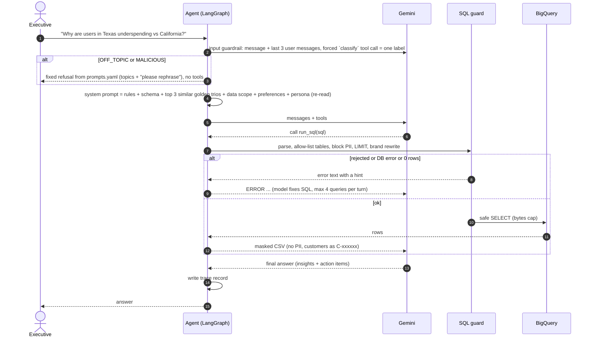
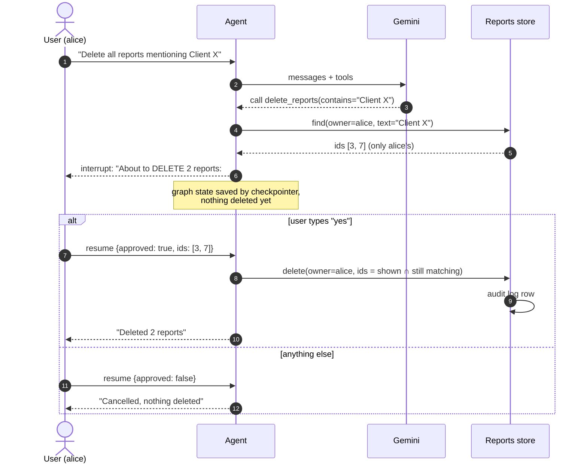
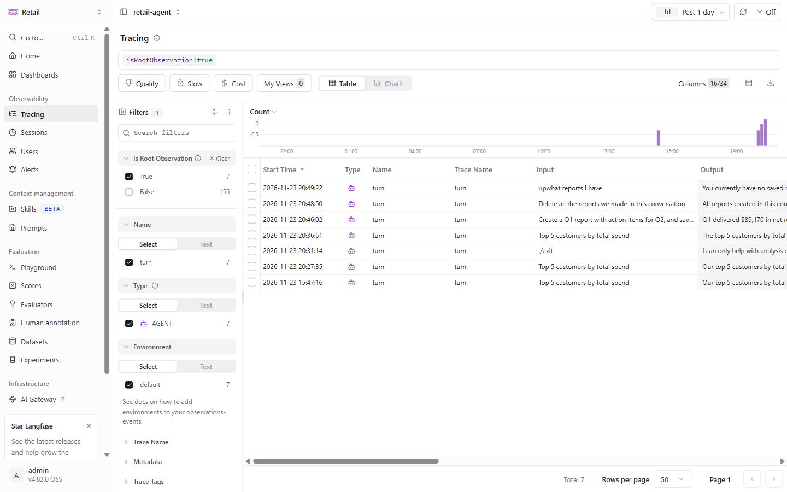
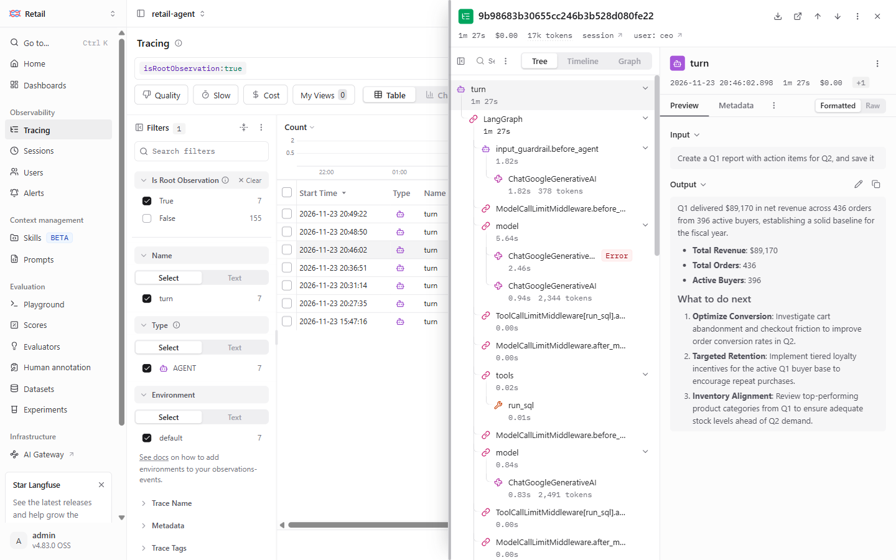
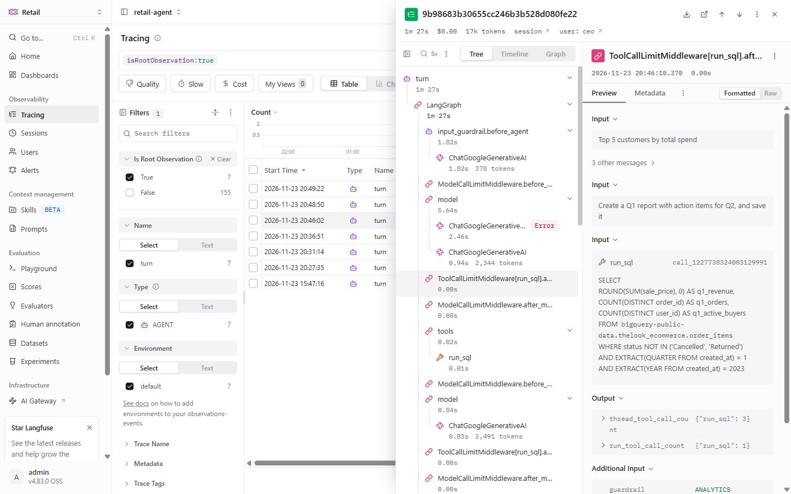

# Technical Design

The production design, how the prototype maps onto it, and how each requirement is solved.
Diagrams: [architecture.md](architecture.md). Setup and example run: [README](../README.md).

## 1. Scope and assumptions

| Assumption | Why it matters |
|---|---|
| Users authenticate with company SSO; the chat front end passes user id, role and allowed brands. | Data access is decided by identity, never by what the user types. |
| "Products related to a user" = a list of brands per user (managed by admins). | Gives a concrete row-level rule: `products.brand IN (...)`. |
| PII = names, email, street address, postal code, exact coordinates. Age, gender, city, state, country are allowed analytic dimensions. | Executives need demographics, not identities. |
| `user_id` is an internal surrogate key, not PII by itself. Result columns named `user_id` / `customer_id` are shown as salted pseudonyms (`C-1a2b3c`); production hashes the id column itself in a BigQuery authorized view. | "Top customers" works without exposing a key that joins back to a person. |
| Golden trios are written and approved by human analysts. | The agent can propose trios, but never publishes them on its own. |
| Production runs on Google Cloud. | BigQuery and Gemini are already there; one cloud, one IAM. |
| "Agent's instructions" in R8 means the tone and format of answers. | Non-developers edit the persona live; rules and guardrails change only with a reviewed release. |
| "Improve itself" (R4) means learning from data, not changing its own code or prompts: per-user notes and new golden trios after human review. No fine-tuning. | A bad session cannot change the agent while it runs; every system-level change has a reviewer. |
| The golden bucket holds hundreds of trios, growing by tens a month. | Hybrid search (keywords + embeddings, top 3) is enough; no metadata filters or re-ranking yet. |
| Executives write in English; answers are in English by default. | One persona and one set of prompts. A language preference can already be stored as a user note. |
| Each executive sees, saves and deletes only their own reports. | Sharing reports with a team is designed (R3) but not built. |
| The dataset is the public `thelook_ecommerce`; data stays in one GCP region. | No data residency or retention rules yet. |

## 2. Production HLD

Diagrams: [architecture.md](architecture.md). Reasons for each service: section 3.

- **Cloud Run** runs the agent: stateless, scales to zero. All state is in Postgres, so any pod can resume a
  paused confirmation.
- **BigQuery enforces data access**: row-level security per brand, policy tags on PII columns. Each job runs as
  the user's brand-group service account (IAM impersonation). The agent's SQL guard is a second layer that also
  gives the model readable errors.
- **One Postgres** holds checkpoints, saved reports, the audit log and user memory (LangGraph
  `PostgresSaver` / `PostgresStore`). A paused delete survives a page reload: the UI reads the pending interrupt
  from the checkpoint.
- **Golden trios** are files in GCS, easy to review. The searchable copy is a BigQuery vector index; hybrid
  search puts the top 3 into the prompt (R1).
- **Learning runs after the session**: a memory analyser updates the user's notes (one per topic, at most 20,
  all in every prompt), and a like starts a golden miner. No extra model calls inside a turn (R4).
- **Cost per user**: Gemini requests and BigQuery jobs carry `user` / `conversation` / `agent_version` labels,
  so the billing export shows cost per user and per release.
- **Model**: the prototype uses Gemini 3.5 Flash-Lite with 3.8 Flash as fallback, for cost. Production picks
  the model by measurement (section 3).

## 3. Technology choices

### Framework: LangGraph (via LangChain `create_agent`)

Why:

- **The standard for production agents** (the author has used LangGraph and LangChain daily for over two years):
  a maintained runtime and ecosystem; tool loops, human confirmation and persistent state are library features.
- **Tracing for free**: the Langfuse `CallbackHandler` nests the guardrail, model calls and tool calls under one
  trace per turn (R7).
- **Built at startup from config**: `build_agent` combines the tools of enabled skills, the middleware stack and
  the checkpointer. A new skill is one YAML file and one module (section 7).

What we use:

- `create_agent`: a compiled graph, model node and tool node in a loop.
- `interrupt()` + checkpointer: the delete confirmation pauses, is persisted, and any server resumes it.
- Middleware instead of custom code: `ModelRetryMiddleware` (backoff), `ModelFallbackMiddleware` (second model),
  `ModelCallLimitMiddleware` / `ToolCallLimitMiddleware` (cost caps), `dynamic_prompt` (persona and preferences
  re-read per call).
- Provider-neutral: the model is one env var, `LLM_MODEL`.
- Rejected: Deep Agents. Planning, a virtual filesystem and sub-agents are not needed for question → SQL →
  report, and make safety and cost harder to reason about.

### LLM: Gemini

**Prototype, chosen for cost**: `gemini-3.5-flash-lite`, the cheapest current Gemini with function calling;
`gemini-3.8-flash` answers if it fails or is rate-limited. Trios are embedded with `gemini-embedding-001`.

**Production, chosen by measurement**: the cheapest model that handles our questions well enough.

1. Dataset: golden trios, the assignment's examples and pilot questions, each with reference SQL and the facts a
   good answer must contain.
2. Run each candidate (Flash-Lite, Flash, Pro, others on Vertex AI) with the same prompts and tools. Measure
   result-set match, judge score, cost per answer and latency.
3. Pick the cheapest that passes the bar. If only long reports need a stronger model, route just those to it.
4. Re-run on every new model version, prompt change or price change (the eval gate in R6).

### Cloud services (GCP)

| Need | Service | Why this one |
|---|---|---|
| Run the agent | **Cloud Run** | Stateless containers, autoscaling, scale to zero, IAM-integrated. |
| AuthN in front | **IAP / API Gateway** | SSO without writing auth code; passes a signed identity header. |
| Data | **BigQuery** | Source of truth; native row-level security, column policy tags, `maximum_bytes_billed`. |
| Conversation state, reports, memory | **Cloud SQL Postgres** | LangGraph `PostgresSaver` / `PostgresStore` exist; transactions for delete + audit. |
| Golden bucket | **GCS** (files) + **BigQuery vector index** (search) | Files are reviewable by analysts; vector search sits next to the data. |
| Persona / prompts | **Firestore** + small admin page | Non-developers edit text; agent reads it on every turn; version history per doc. |
| Events for learning loop | **Pub/Sub → BigQuery** | Decouples the chat path from analytics. |
| Secrets | **Secret Manager** | API keys never in images or env files. |
| Observability | **Cloud Logging, Cloud Monitoring, Langfuse** | Infra metrics + LLM-level traces of every prompt/tool call. |

## 4. Data flow

One turn:

1. **Identity.** The UI sends `{user_id, conversation_id, text}`; IAP adds the verified identity. Role and brand
   group come from the entitlements table in Postgres (synced from IdP groups).
2. **Guardrail.** One model call must call `classify` with `ANALYTICS`, `OFF_TOPIC` or `MALICIOUS`. Only
   `ANALYTICS` goes on; the rest get a fixed reply and are dropped from the history.
3. **Prompt.** Rules + schema (PII columns marked) + top 3 golden trios + data scope + preferences + persona.
   Schema and trios sit in the prompt, not behind tools, so a typical question costs 3 model calls (guardrail,
   SQL, answer) instead of 5.
4. **Query.** `run_sql` → SQL guard → BigQuery job with `maximum_bytes_billed`, run as the brand group's service
   account (the Cloud Run identity holds `roles/iam.serviceAccountTokenCreator` on it). BigQuery's row-level
   policy therefore applies independently of the guard.
5. **Result.** Rows → PII mask (drop columns, pseudonymise ids) → at most 50 rows / 8,000 characters of CSV →
   model. The model loops at most 4 queries and 12 model calls per turn.
6. **Answer.** Streamed over SSE with progress events, since a multi-query answer takes 10–30 s. A turn event
   (tokens, latency, models, queries, errors) goes to logs and Pub/Sub.

## 5. Requirements

### R1. Hybrid intelligence (golden bucket)

**Storage.** Trios are files in GCS. On publish, a job embeds each trio once into a BigQuery table with a vector
index (text, vector, topic, tables, date). At tens of thousands of trios, or if search needs fast filters by
topic and date, the records move to Qdrant; only the retrieval adapter changes.

**Query time.** The question is embedded once per turn. Hybrid search (vector + keyword, combined score) puts
the top N trios above a threshold into the system prompt, with no tool call; N is tuned on data (3 now).
Keywords catch exact terms (AOV), embeddings catch synonyms ("sales" for revenue). The analyst's interpretation
matters most: definitions like "net revenue excludes returns" are what the schema cannot tell the model.

**Updates.** Liked sessions become trios via the golden miner, analyst review and publish (R4). Superseded trios
are tombstoned, not deleted, so old answers stay explainable.

### R2. Safety and PII masking

Safety lives in code, not in the prompt; identity and brands come from SSO, not from the chat.
`sql_guard.py` passes only one read-only `SELECT` over the 4 tables, without PII columns, limited to a brand
executive's brands. `pii.py` drops PII columns and pseudonymises customer ids before the model sees rows. So
even if a user talks the model into `SELECT email FROM users`, the guard rejects it before BigQuery. In
production, BigQuery row-level policies and PII policy tags back this up.

### R3. Destructive operations

`delete_reports` finds only the caller's reports and pauses the agent (`interrupt()`) with the exact list. Only
`yes` proceeds; anything else cancels. It deletes the reports that were shown and still match; the store
re-checks the owner and writes an audit row per delete. A report created after the preview, or a forged id, is
never deleted. The pause survives a page reload. Production: soft delete with 30-day restore, owner-only even
with team sharing.

### R4. Continuous improvement

Two levels, both learned in the background from finished sessions: no extra model calls in a turn, and a bad
session cannot change the agent while it runs. When a session ends, a `session_closed` event (user, thread, like
or dislike) goes to Pub/Sub and two Cloud Run jobs react.

**User level.** An LLM memory analyser reads the PII-masked session and the user's current notes, then rewrites
the notes: adds preferences on format, depth, charts or language, merges conflicts, drops stale ones. Notes live
in Postgres and go into every prompt below the rules. The SQL guard never reads them, and the current message
always beats memory.

**System level.** A like starts the golden miner. For each turn it turns the question, the SQL that ran and the
answer into a trio: SQL re-run through the guard, text PII-masked, near-duplicates dropped. After analyst
approval the trio goes to GCS, the vector index and the eval set (R6). Dislikes, SQL errors and empty results are
clustered weekly into eval cases and prompt fixes; a change ships only if the offline eval does not regress.

### R5. Resilience and error handling

Most failures go back to the model as an error it can fix: SQL error, empty result (with a hint to check values
via `SELECT DISTINCT`), bytes cap exceeded, BigQuery job over 60 s, tool crash. Per turn: at most 4 queries and
12 model calls; a result reaches the model as at most 50 rows / 8,000 characters. Model API failures (429, 5xx,
timeout) are retried 3 times with backoff, then the fallback model answers; a used-up daily quota goes straight
to the fallback. If everything is down, the user gets a short message with the trace id and the session goes on.

Production adds a circuit breaker per dependency, a result cache and a per-user daily token budget. Long
conversations are trimmed by middleware: old `run_sql` results cleared, old turns summarised.

### R6. Quality assurance

**Prototype.** Offline tests, no keys needed: SQL guard, brand filter, PII masks, report ownership, and the full
agent loop with a scripted fake model. `scripts/live_demo.py` runs the same scenarios on real Gemini and BigQuery
and writes [live-demo.md](live-demo.md).

**Production.** An eval set of 100–200 questions with reference SQL gates every release: result sets must match,
an LLM judge scores the answers, injection and PII-leak prompts must leak nothing. A release ships only if
nothing regresses.

**LLM as a judge** *(not in the prototype)*. A stronger model than the agent's gets the question, query results
and answer, and scores 1–5 with a one-line reason per criterion: answers the question, numbers match the
results, insights follow from the data, action items are concrete, tone follows the persona. It is calibrated on
analyst-scored samples and recalibrated when its model or rubric changes. It runs before each release and daily
on a sample of production turns; low scores go to analyst review with dislikes and re-asked questions.

### R7. Observability

The prototype traces every turn in Langfuse (run locally by `docker compose`): one trace per turn, tagged with
user and session, with every model call, tool call, SQL query, tokens and latency.

One turn as a tree: guardrail, a failed model call and its retry, `run_sql`, tokens and latency per step.

One step in full: the SQL the model sent and the guardrail label.

Production dashboards track error rate, latency, SQL error and empty-result rates, guard rejections, fallback
rate, cost per user and dislike rate, with alerts on spikes. Every error message shows a trace id that leads to
the Langfuse trace and the BigQuery job.

### R8. Persona management

The CEO office edits the tone in an admin page (a versioned Firestore document). The agent re-reads it on every
model call, so a change applies on the next message without a redeploy. The persona sets tone and format only;
safety rules stay in code.

## 6. Prototype in this repo

The prototype runs the same agent with local stand-ins. It has no background jobs: no like / dislike, memory
analyser or golden miner.

| Production | Prototype |
|---|---|
| Cloud Run + IAP | CLI, users from `config/users.yaml` |
| Postgres | SQLite + `data/prefs.json` |
| BigQuery row-level security | SQL guard's brand rewrite |
| Vector index | `config/golden/*.yaml`, searched in memory |
| Firestore persona | `config/persona.md` |
| Langfuse + Cloud Logging | Langfuse in `docker compose` + `logs/traces.jsonl` |

## 7. Extensibility

Everything the model reads is config: rules in `config/prompts.yaml`, SQL in `config/sql.yaml`, tone in
`config/persona.md`, analyst examples in `config/golden/`, users in `config/users.yaml`. A new capability is a
skill: `config/skills/<name>.yaml` (instructions, tool descriptions) plus a small Python module with
`make_tools`; agent code does not change. Shipped: `sql_analysis`, `saved_reports`, `preferences`, and `charts`
as a disabled example. Chart images, e-mailing a report (behind the same confirmation as deletes) and web search
would be added the same way.
