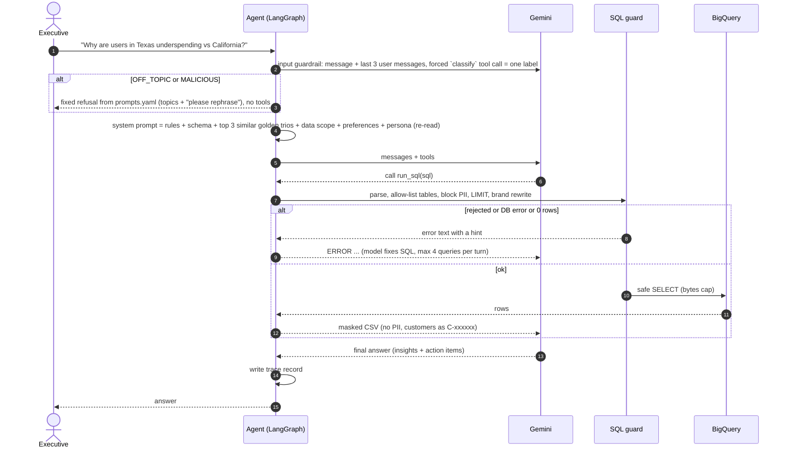
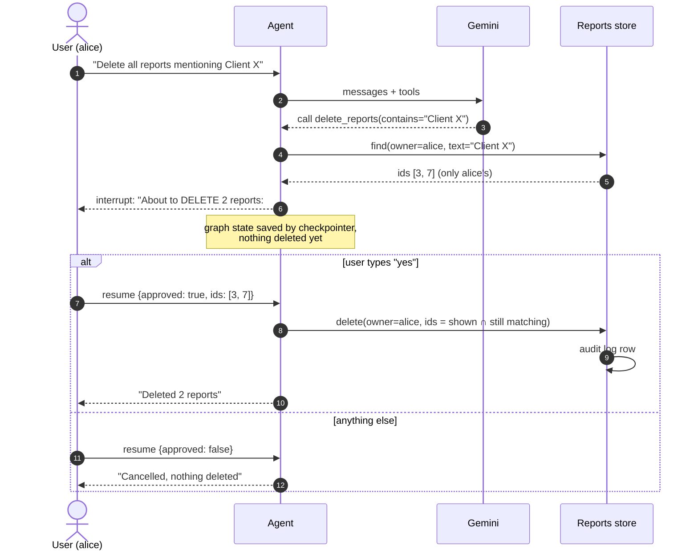

# Technical Design

How the system works in production, how the prototype in this repo maps onto it, and how each requirement is
solved. Diagrams: [architecture.md](architecture.md). Setup and example run: [README](../README.md).

Status: prototype complete. Sections marked *(prototype)* describe code in this repo; the rest is the production design.

## 1. Scope and assumptions

| Assumption | Why it matters |
|---|---|
| Users authenticate with company SSO; the chat front end passes user id, role and allowed brands. | Data access is decided by identity, never by what the user types. |
| "Products related to a user" = a list of brands per user (managed by admins). | Gives a concrete row-level rule: `products.brand IN (...)`. |
| PII = names, email, street address, postal code, exact coordinates. Age, gender, city, state, country are allowed analytic dimensions. | Executives need demographics, not identities. |
| `user_id` is an internal surrogate key, not PII by itself. Result columns named `user_id` / `customer_id` are shown as salted pseudonyms (`C-1a2b3c`); production hashes the id column itself in a BigQuery authorized view. | "Top customers" works without exposing a key that joins back to a person. |
| Golden trios are written and approved by human analysts. | The agent can propose trios, but never publishes them on its own. |
| Production runs on Google Cloud. | BigQuery and Gemini are already there; one cloud, one IAM. |
| "Agent's instructions" in R8 means the tone and format of answers. | Non-developers edit the persona live; rules and guardrails change only with a reviewed release. |
| "Improve itself" (R4) means learning from data, not changing its own code or prompts: per-user notes and new golden trios after human review. No fine-tuning. | A bad session cannot change the agent while it runs; every system-level change has a reviewer. |
| The golden bucket holds hundreds of trios, growing by tens a month. | Hybrid search (keywords + embeddings, top 3) is enough; no metadata filters or re-ranking yet. |
| Executives write in English; answers are in English by default. | One persona and one set of prompts. A language preference can already be stored as a user note. |
| Each executive sees, saves and deletes only their own reports. | Sharing reports with a team is designed (R3) but not built. |
| The dataset is the public `thelook_ecommerce`; data stays in one GCP region. | No data residency or retention rules yet. |

## 2. Production HLD

The diagrams are in [architecture.md](architecture.md). Key choices, each explained in section 3:

- **Cloud Run** for the agent: stateless, scales to zero, all state lives in Postgres, so any pod can resume a paused
  confirmation.
- **BigQuery** enforces data access itself (row-level security per brand, policy tags on PII columns). The agent
  looks up the user's brand group in Postgres and runs the job as that group's service account (IAM
  impersonation), so a row-level policy granted to the group applies. The SQL guard inside the agent is a second,
  independent layer that also gives the model readable errors.
- **Model choice**: the prototype uses Gemini 3.5 Flash-Lite with 3.8 Flash as fallback to keep its cost low.
  Production picks the model from measurements, not from this default (see "LLM: Gemini" in section 3).
- **One Postgres** holds conversation checkpoints, saved reports, audit log and user memory: LangGraph ships
  `PostgresSaver`/`PostgresStore`, so there is no extra store to run. A paused delete confirmation survives a page
- **Learning happens after the session, in the background**: when a session closes, a memory analyser
  updates that user's short note list (one note per topic, at most 20, put whole into every system prompt), and
  a like starts a golden miner agent that proposes new trios for analyst review. No memory framework or
  retrieval for user memory, and no extra model calls inside a turn (§R4).
  reload: the UI reads the pending interrupt from the checkpoint and shows the list again.
- **Cost per user**: Gemini requests and BigQuery jobs carry `user` / `conversation` / `agent_version` labels, so
  the billing export gives cost per user and per release; long conversations are trimmed by context-editing and
  summarisation middleware (R5).
- **Golden trios** live as files in GCS (easy for analysts to review in Git or the console). The searchable copy is a
  BigQuery table with embeddings and a vector index, next to the data it describes. Retrieval is **hybrid**: vector
  search catches synonyms ("sales" for revenue), keyword match catches exact terms (AOV, table names); the scores are
  combined and the top 3 above a threshold go into the prompt (see R1).

## 3. Technology choices

### Framework: LangGraph (via LangChain `create_agent`)

Why LangGraph:

- **The current standard for agents.** In the author's experience (more than two years of daily work with LangGraph and LangChain) it is what production agent teams build on today:
  a maintained graph runtime, a large ecosystem, and the patterns this assignment needs (tool loops, human
  confirmation, persistent state) as library features rather than custom code.
- **Observability out of the box.** Langfuse plugs in as a LangChain callback (`langfuse.langchain.CallbackHandler`):
  every turn becomes one trace with the guardrail, each model call and each tool call nested under it, without
  hand-written instrumentation (R7).
- **The agent is assembled at runtime to our requirements.** `build_agent` composes the graph when the service
  starts: tools from the skills enabled in `config/skills/*.yaml`, our middleware stack (input guardrail, dynamic
  prompt, retries, fallback, limits), and the checkpointer. Nothing about the agent's shape is hard-coded.
- **Flexible and easy to extend.** A new tool or skill is one YAML file and one module; the graph picks it up on the
  next start and the guardrails apply to it automatically (section 7). Deeper changes (sub-agents, long-running
  report jobs) use the same graph primitives.

What we use from it:

- `create_agent` returns a compiled **LangGraph** graph: model node + tool node in a loop. We get the graph runtime
  without writing one by hand.
- **`interrupt()` + checkpointer** is exactly the primitive the delete-confirmation flow needs: the graph pauses,
  state is persisted, and any server can resume it later with the user's answer.
- **Middleware** covers resilience with library code instead of custom code: `ModelRetryMiddleware` (backoff),
  `ModelFallbackMiddleware` (second model), `ModelCallLimitMiddleware` / `ToolCallLimitMiddleware` (cost caps),
  `dynamic_prompt` (persona and preferences re-read per call).
- Provider-neutral: `LLM_MODEL=google_genai:gemini-3.5-flash-lite` or any other model, one env var.
- Considered and rejected: Deep Agents (planning, virtual filesystem and sub-agents are not needed for question → SQL → report, and they make it harder to reason about safety and cost).

### LLM: Gemini

**Prototype: chosen to keep cost low.** The agent runs on `gemini-3.5-flash-lite`, the cheapest current Gemini
with function calling. If it fails or is rate-limited, `gemini-3.8-flash` answers instead. Golden trios are
embedded with `gemini-embedding-001`.

**Production: chosen by measurement.** The right model is the cheapest one that handles our questions well enough,
and only data can show which that is:

1. Build a dataset of the questions executives will actually ask: the golden trios, the assignment's examples, and
   real questions from a pilot, each with a reference SQL and the facts a good answer must contain.
2. Run each candidate (Flash-Lite, Flash, Pro, and others on Vertex AI) on the whole set with the same prompts and
   tools, and measure quality (result sets match the reference, judge score for the report), cost per answer and
   latency.
3. Pick the cheapest model that passes the quality bar. If only long reports need a stronger model, route those
   requests to it and keep the rest on the cheaper one.
4. Re-run the same set whenever a new model version, a prompt change or a price change comes out (the eval gate in
   R6).

### Cloud services (GCP)

| Need | Service | Why this one |
|---|---|---|
| Run the agent | **Cloud Run** | Stateless containers, autoscaling, scale to zero, IAM-integrated. |
| AuthN in front | **IAP / API Gateway** | SSO without writing auth code; passes a signed identity header. |
| Data | **BigQuery** | Source of truth; native row-level security, column policy tags, `maximum_bytes_billed`. |
| Conversation state, reports, memory | **Cloud SQL Postgres** | LangGraph `PostgresSaver` / `PostgresStore` exist; transactions for delete + audit. |
| Golden bucket | **GCS** (files) + **BigQuery vector index** (search) | Files are reviewable by analysts; vector search sits next to the data. |
| Persona / prompts | **Firestore** + small admin page | Non-developers edit text; agent reads it on every turn; version history per doc. |
| Events for learning loop | **Pub/Sub → BigQuery** | Decouples the chat path from analytics. |
| Secrets | **Secret Manager** | API keys never in images or env files. |
| Observability | **Cloud Logging, Cloud Monitoring, Langfuse** | Infra metrics + LLM-level traces of every prompt/tool call. |

## 4. Data flow

One turn:

1. The UI sends `{user_id, conversation_id, text}`; IAP adds verified identity; the service loads the user's role
   and brand group from the entitlements table in Postgres (admins edit it; synced from IdP groups).
   An input guardrail (one model call) must call the `classify` tool with a label from an enum (`ANALYTICS`, `OFF_TOPIC`, `MALICIOUS`); code reads
   the label, and only `ANALYTICS` goes on. Other messages get a fixed reply and are dropped from the history.
2. The agent builds the system prompt: fixed rules + table schema (PII columns marked) + the top 3 golden trios most
   similar to the question (question, SQL, analyst interpretation) + data scope + the user's preferences + persona.
   Schema and trios are in the prompt, not behind tools, so a typical question costs 3 model calls
   (guardrail, write SQL, then answer) instead of 5.
3. Gemini calls `run_sql`.
4. `run_sql` → SQL guard (parse, allow-list, PII block, LIMIT, brand rewrite) → BigQuery job with
   `maximum_bytes_billed`. The job runs as the brand group's service account (the Cloud Run identity holds
   `roles/iam.serviceAccountTokenCreator` on one service account per group and impersonates it), so the
   BigQuery row-level access policy granted to that group also applies, independently of the guard.
5. Rows → PII mask (drop PII columns, pseudonymise ids) → at most 50 rows and 8,000 characters as CSV → model.
6. The model answers, or loops (max 4 SQL queries and 12 model calls per turn).
7. Final text → user, streamed over SSE with progress events ("running query…"),
   since a multi-query answer takes 10–30 s. A turn event (tokens, latency, models, queries, errors) → logs + Pub/Sub.

## 5. Requirements

### R1. Hybrid intelligence (golden bucket)

**Storage.** Trios are files in GCS. When a trio is published, a job embeds it once and writes the vector,
the trio text and its metadata (topic, tables, date) to a vector store. The default store is a BigQuery table
with a vector index, next to the data it describes. If the bucket grows to tens of thousands of trios, or search
needs filters by topic and date with low latency, the same records move to Qdrant; only the retrieval adapter
changes.

**At query time.** The question is embedded once per turn. A hybrid search in the store (vector similarity +
keyword match, scores combined) returns N closest trios above a threshold (exact number should be chosen based on dataset), and they go into the system
prompt, with no extra tool call. Keywords catch exact terms (AOV), embeddings catch synonyms ("sales" for
revenue). The interpretation matters most: definitions such as "net revenue excludes returns" are what the
schema cannot tell the model.

**Updating over time.** Sessions the user likes are turned into new trios by a background golden miner
agent, deduplicated against existing trios, reviewed by an analyst and published to GCS and the vector index
(R4, system level). Superseded trios are tombstoned, not deleted, so old answers stay explainable.

### R2. Safety and PII masking

Safety is enforced in code, not by the prompt. The user's identity and brands come from SSO, not from the chat.
The SQL guard (`sql_guard.py`) lets through only one read-only `SELECT` over the 4 tables, without PII columns,
and limits a brand executive's query to their brands. Before the model sees a result, `pii.py` drops PII columns
and replaces customer ids with pseudonyms. So even if a user talks the model into `SELECT email FROM users`, the
guard rejects it before BigQuery. In production, BigQuery row-level policies and PII policy tags back this up.

### R3. Destructive operations

`delete_reports` finds only the caller's reports and pauses the agent (LangGraph `interrupt()`) with the exact
list. The user must type `yes`; anything else cancels. On `yes` the tool deletes only the reports that were shown
and still match, the store re-checks the owner, and each delete writes an audit row. A report created after the
preview, or a forged id, is never deleted. The pause is saved in the checkpoint, so after a page reload the UI
shows the same list again. In production deletes are soft, with a 30-day restore; if reports are shared with a
team, delete stays owner-only.

### R4. Continuous improvement

The agent improves in two ways: **user level**, it remembers each user's preferences, and **system level**, liked
sessions become new golden trios that R1 searches. Both learn in the background from finished sessions, never
inside a user's turn, so a turn costs no extra model calls and a bad session cannot change the agent while it runs.
When a session ends, the app sends a `session_closed` event (user, thread,
like or dislike) to Pub/Sub, and two Cloud Run jobs react to it.

**User level.** In the background, an LLM memory analyser reads the finished session (PII-masked) together with
the user's current notes and rewrites the notes: it adds new preferences on format, depth, charts or language,
updates or merges notes that conflict, and drops ones the user no longer follows. The notes live in Postgres per
user and go into every prompt, below the rules; the SQL guard never reads them. The current message always beats
memory.

**System level.** A like starts a golden miner agent. For each turn it takes the question, the SQL that actually
ran and the answer, and writes a trio. The SQL is re-run through the guard, the text is PII-masked, and
near-duplicates of existing trios are dropped. An analyst approves the trio, then it is published to the GCS
golden bucket, embedded into the vector index and added as an eval case (R6). Dislikes, SQL errors and empty
results are clustered weekly into eval cases and prompt fixes; a change ships only if the offline eval does not
regress.

### R5. Resilience and error handling

Most failures go back to the model as an error message, and it fixes its own query: a SQL error, an empty result
(with a hint to check values via `SELECT DISTINCT`), a query over the bytes cap, a BigQuery job slower than 60 s,
or a crashing tool. A turn may run at most 4 queries and 12 model calls, and a result reaches the model as at most
50 rows and 8,000 characters. If the model API fails (429, 5xx, timeout), it is retried 3 times with backoff, then
the fallback model answers; a used-up daily quota goes straight to the fallback. If everything is down, the user
gets a short message with the trace id and the session goes on.

Production adds a circuit breaker per dependency, a result cache and a per-user daily token budget. Long
conversations are trimmed by LangChain middleware: old `run_sql` results are cleared and old turns summarised.

### R6. Quality assurance

The prototype has offline unit tests that need no keys: the SQL guard, the brand filter, PII masks, report
ownership and the full agent loop with a scripted fake model. `scripts/live_demo.py` runs the same scenarios on
real Gemini and BigQuery and writes [live-demo.md](live-demo.md). In production, an eval set of 100-200 questions
with reference SQL checks every release: result sets must match, an LLM judge scores the answers, and injection
and PII-leak prompts must leak nothing. A release ships only if nothing regresses.

**LLM as a judge.** A stronger model than the agent's gets the question, the query results and the final answer,
and scores each answer 1-5 against a rubric: it answers the question, every number matches the query results,
insights follow from the data, action items are concrete, tone follows the persona. It returns a score and a
one-line reason per criterion as structured output. The judge is calibrated on a sample that analysts scored by
hand, and recalibrated when its model or rubric changes. It runs on the eval set before each release and daily on
a sample of production turns; low scores go to analyst review, next to dislikes and re-asked questions. *(not in
the prototype)*

### R7. Observability

The prototype traces every turn in Langfuse, which `docker compose` runs locally: one trace per turn, tagged with
user and session, with every model call, tool call, SQL query, tokens and latency.

One turn as a tree: the input guardrail, a failed model call and its retry, `run_sql`, tokens and latency per step.

One step in full: the SQL the model sent and the guardrail label.

Production dashboards track error rate, latency, SQL error and empty-result rates, guard rejections, fallback
rate, cost per user and the dislike rate, with alerts on spikes. Gemini requests and BigQuery jobs carry `user` and
`conversation` labels, so cost per user is a billing query. Every error message shows a trace id that leads to the
Langfuse trace and the BigQuery job.

### R8. Persona management

The CEO office edits the tone in an admin page (a versioned Firestore document). The agent re-reads it at every
model call, so a change applies on the next message without a redeploy. The persona changes tone and format only;
safety rules stay in code.

## 6. Prototype in this repo

The prototype runs the same agent with local stand-ins: a CLI with users from `config/users.yaml` instead of
Cloud Run and IAP; SQLite and `data/prefs.json` instead of Postgres; the SQL guard's rewrite instead of BigQuery
row-level security; `config/golden/*.yaml` searched in memory instead of a vector index; `config/persona.md`
instead of Firestore; Langfuse in `docker compose` and `logs/traces.jsonl` for tracing. It has no background
jobs: no like / dislike, memory analyser or golden miner.

## 7. Extensibility

Everything the model reads is configuration: rules in `config/prompts.yaml`, SQL in `config/sql.yaml`, tone in
`config/persona.md`, analyst examples in `config/golden/`, users in `config/users.yaml`. A new capability is a
skill: `config/skills/<name>.yaml` (instructions and tool descriptions) plus a small Python module with
`make_tools`; the agent code does not change. The prototype ships `sql_analysis`, `saved_reports` and
`preferences`, plus `charts` as a disabled example. Charts as images, e-mailing a report (behind the same
confirmation as deletes) and web search would be added the same way.
